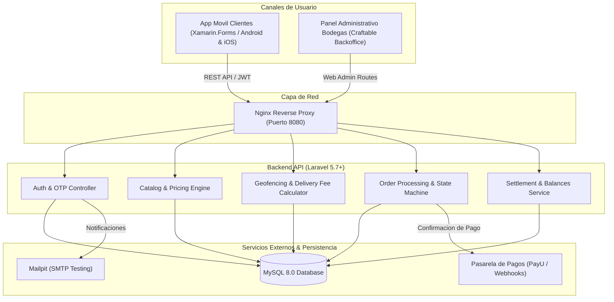

# NUAP: On-Demand Beverage Delivery Platform

[](https://github.com/KevinAndrey96/android-nuap-delivery-platform/actions/workflows/ci.yml)
[](https://www.php.net)
[](https://laravel.com)
[](https://dotnet.microsoft.com/apps/xamarin)
[](https://www.mysql.com)
[](https://www.docker.com)
[](LICENSE)

Plataforma integral de comercio electronico y logistica de entrega bajo demanda para bebidas frias, refrescos, snacks y articulos de fiesta. La solucion conecta en tiempo real a consumidores finales mediante una aplicacion movil nativa, comercios aliados (bodegas y tiendas de conveniencia) para el alistamiento inmediato y una red de repartidores motorizados para el despacho agil de pedidos.

---

## Arquitectura del Sistema

El ecosistema opera bajo un esquema monorepo desacoplado que centraliza el backend transaccional en Laravel, el panel administrativo para comercios y la aplicacion movil multiplataforma para clientes.



---

## Estructura del Monorepo

```
android-nuap-delivery-platform/
├── .github/
│   └── workflows/
│       └── ci.yml               # Pipeline de integracion continua automatizado
├── apps/
│   └── mobile-customer/         # Aplicacion movil para consumidores (Xamarin.Forms)
│       ├── nuap/                # Logica compartida, ViewModels, Modelos y Vistas XAML
│       ├── nuap.Android/        # Proyecto especifico para la plataforma Android
│       ├── nuap.iOS/            # Proyecto especifico para la plataforma iOS
│       └── nuap.sln             # Solucion de Visual Studio / .NET
├── backend/                     # Backend API y Panel de Administracion (Laravel)
│   ├── app/
│   │   ├── Http/Controllers/Api # Controladores de la API REST (catalogo, ordenes, OTP)
│   │   ├── Http/Middleware      # Validacion de tokens JWT y autorizacion
│   │   └── Models/              # Modelos Eloquent (Order, Product, Commerce, User)
│   ├── config/                  # Configuraciones de base de datos, auth y servicios
│   ├── database/migrations/     # Migraciones estructurales de la base de datos
│   ├── routes/api.php           # Definicion de endpoints REST para la app movil
│   └── composer.json            # Dependencias del backend
├── database/
│   ├── schema.sql               # Esquema completo DDL para MySQL 8.0 / 5.7
│   └── seeds.sql                # Catalogo inicial de prueba y comercios
├── docker/
│   ├── nginx/default.conf       # Configuracion de servidor web con compresion y FastCGI
│   └── php/Dockerfile           # Imagen de PHP-FPM con extensiones pdo_mysql y gd
├── docker-compose.yml           # Orquestacion de contenedores locales
├── Makefile                     # Automatizacion de comandos de desarrollo
└── README.md                    # Documentacion tecnica del repositorio
```

---

## Flujo de Negocio y Ciclo del Pedido

1. **Autenticacion:** Registro de clientes y validacion de identidad mediante codigos OTP por SMS / Celular y tokens JWT persistentes.
2. **Geolocalizacion y Cobertura:** El cliente registra su direccion GPS; el motor de calculo identifica las bodegas mas cercanas dentro del radio de entrega definido en la configuracion del sistema.
3. **Catalogo Dinamico:** Consulta de productos en tiempo real con precios diferenciados, promociones y disponibilidad de inventario segun el punto de venta asignado.
4. **Calculo de Tarifa de Despacho:** Calculo automatico del costo de despacho segun la distancia euclidiana/GPS entre el punto de venta y la direccion destino.
5. **Maquina de Estados del Pedido:**
   - `Iniciado`: El cliente envia la orden desde el carrito.
   - `Aceptado`: El comercio confirma la recepcion del pedido.
   - `Alistamiento`: La bodega empaca los productos solicitados.
   - `Circulacion`: El repartidor motorizado recoge el paquete e inicia la ruta.
   - `Entregado`: Se finaliza la entrega y se confirma el pago contra entrega o pasarela digital.
6. **Liquidacion y Billetera de Aliados:** Conciliacion automatica de comisiones por venta, acumulacion de saldos y solicitudes de retiro para cuentas bancarias de los comercios.

---

## Principales Endpoints de la API REST

| Metodo | Ruta | Descripcion |
| :--- | :--- | :--- |
| `POST` | `/api/users/generate-otp` | Genera y envia codigo OTP para verificacion de telefono |
| `POST` | `/api/users/verify-otp` | Valida el codigo OTP e inicia sesion devolviendo el token |
| `POST` | `/api/users/register/client` | Registro de nuevos clientes en la plataforma |
| `GET` | `/api/users/location` | Lista las direcciones y ubicaciones guardadas del usuario |
| `POST` | `/api/users/location/create` | Registra una nueva coordenada GPS y direccion de entrega |
| `GET` | `/api/products/categories` | Lista las categorias del catalogo (bebidas, snacks, articulos) |
| `GET` | `/api/products/category/{cat}/address/{addr}` | Productos filtrados por categoria segun cobertura |
| `GET` | `/api/products/featured/address/{addr}` | Productos destacados y promociones de la zona |
| `POST` | `/api/products/calculate-delivery` | Calcula la tarifa de envio segun distancia al comercio |
| `POST` | `/api/products/create-order/address/{addr}` | Creacion y formalizacion de orden de pedido |
| `GET` | `/api/users/orders` | Historial de pedidos realizados por el usuario |
| `GET` | `/api/commerces/sales` | Reporte de ventas y pedidos para comercios aliados |
| `POST` | `/api/confirm-payment` | Webhook de confirmacion de transacciones de pasarela |

---

## Puesta en Marcha Local con Docker

### Prerrequisitos
- Docker Engine 24+ y Docker Compose v2+
- Make (opcional, para utilizar atajos de terminal)

### Instalacion rapida

1. Clonar el repositorio:
   ```bash
   git clone git@github.com:KevinAndrey96/android-nuap-delivery-platform.git
   cd android-nuap-delivery-platform
   ```

2. Configurar el archivo de variables de entorno del backend:
   ```bash
   cp backend/.env.example backend/.env
   ```

3. Levantar los servicios en segundo plano:
   ```bash
   make up
   # o alternativamente: docker compose up -d
   ```

4. Cargar el esquema y datos de prueba:
   ```bash
   make reset-db
   ```

5. Acceso a los servicios:
   - **API y Servidor Web:** [http://localhost:8080](http://localhost:8080)
   - **Mailpit (Bandeja de correos de prueba):** [http://localhost:8025](http://localhost:8025)
   - **Base de Datos MySQL:** `localhost:3306` (Usuario: `nuap_user`, Clave: `nuap_secret`)

---

## Comandos Utiles del Makefile

```bash
make help        # Muestra la lista de comandos disponibles
make up          # Inicia todos los contenedores en segundo plano
make down        # Detiene los contenedores
make logs        # Visualiza los registros en tiempo real
make sh          # Abre una sesion bash dentro del contenedor PHP
make seed        # Carga los registros de prueba
make reset-db    # Reinicia completamente el esquema y la data inicial
make lint        # Ejecuta analisis sintactico de los archivos PHP
```

---

## Pipeline de Integracion Continua (CI)

El proyecto cuenta con un flujo automatizado en GitHub Actions configurado en `.github/workflows/ci.yml`:
- **PHP Lint & Code Quality:** Valida la compatibilidad sintactica en PHP 7.4 y PHP 8.1.
- **Database Schema & Seeds:** Despliega un servicio MySQL 8.0 transitorio, ejecuta el archivo DDL `schema.sql` y verifica la consistencia de los datos con `seeds.sql`.
- **Mobile Client Integrity:** Comprueba la solucion Xamarin, archivos de proyecto y estructura XAML / C# de la aplicacion movil.

---

## Licencia

Este proyecto esta bajo la Licencia MIT. Consulta el archivo [LICENSE](LICENSE) para mas detalles.
